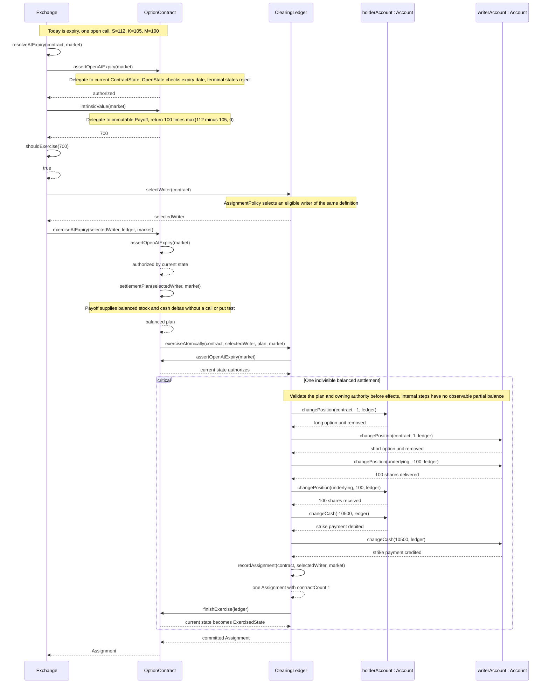

# Automatic call exercise at expiry

One issued call contract from the section 8 example is expanded here:
spot 112, strike 105, multiplier 100, and expiry is today. The configured
exercise threshold is 1.00 per contract, a documented assumption. Intrinsic
value is 700, so the exchange exercises it automatically. In this concrete
trace the selected writer is the current writer; no re-pairing is needed.

The initial premium was transferred on acquisition and is not charged again.
The 700 is the exercise advantage, not the payment: the holder pays 10,500
for 100 shares. Option units close as +1 becomes 0 and -1 becomes 0. Share
deltas sum to zero and cash deltas sum to zero.

The critical fragment expresses the model's logical atomicity. It does not
specify locks, a database or a concurrency implementation. An invalid plan or
terminal-state rejection produces no changes. No other operation can observe
or commit a subset of these effects. recordAssignment is an internal step,
not a second independent assignment request.

For section 8's ten-contract example, resolve ten issued units. Aggregate
delivery is 1,000 shares and exercise cash is 105,000. Each unit's exercise
has one matching assignment of one contract. Bulk exercise allocation is a
recorded granularity limitation.
