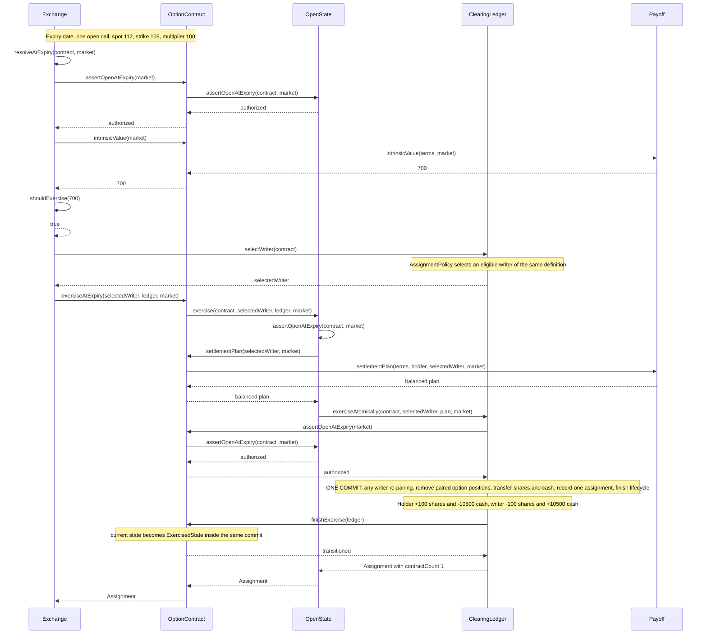

# Automatic call exercise at expiry

One issued call contract from the section 8 example is expanded here:
spot 112, strike 105, multiplier 100, and expiry is today. The exchange uses
the documented design assumption of a 1.00-per-contract exercise threshold.
The call's intrinsic value is 700, so it is exercised automatically.

The initial premium was transferred when the holding was acquired. It is not
charged again during exercise. The 700 is the value advantage, not the cash
payment: the physical exercise pays 10,500 for 100 shares.

For the ten-contract section 8 example, resolve ten issued units. Each
exercise has one assignment of one contract. Aggregate delivery is 1,000
shares and aggregate exercise cash is 105,000. This design deliberately does
not claim that ten one-contract assignments are one ten-contract assignment.
