# Options market class model

This is an AI-assisted model for student review. Requirements come from
`OPTIONS-MARKETS.md` sections 2-6. The rationale defines the operation contracts,
units, invariants, and deliberate simplifications behind this diagram.

```mermaid
classDiagram
    direction TB

    namespace Ownership {
        class Asset {
            <<interface>>
            +unitValue(market) Money
            +assertTradable(market)
        }
        class Stock {
            -String symbol
            +unitValue(market) Money
            +assertTradable(market)
        }
        class Position {
            -Integer units
            +value(market) Money
            ~changeUnits(delta, authority)
        }
        class Account {
            -String accountId
            -Money cashBalance
            +value(market) Money
            ~changePosition(asset, delta, authority)
            ~changeCash(delta, authority)
        }
        class MarketContext {
            +Date asOf
            +Map spots
            +Decimal annualVolatility
            +Decimal annualRate
            +spot(stock) Money
            +yearsTo(expiry) Decimal
        }
    }

    namespace TermsAndPayoffs {
        class OptionDefinition {
            +String listingId
            +Money strike
            +Date expiry
            +Integer multiplier
        }
        class Payoff {
            <<interface>>
            +intrinsicValue(terms, market) Money
            +modelValue(terms, market) Money
            +settlementPlan(terms, holder, writer, market) SettlementPlan
        }
        class SignedVanillaPayoff {
            <<abstract>>
            -Integer direction
            #SignedVanillaPayoff(coefficient)
            +intrinsicValue(terms, market) Money
            +modelValue(terms, market) Money
            +settlementPlan(terms, holder, writer, market) SettlementPlan
        }
        class CallPayoff {
            +CallPayoff()
        }
        class PutPayoff {
            +PutPayoff()
        }
    }

    namespace ContractLife {
        class OptionContract {
            -String contractId
            +unitValue(market) Money
            +assertTradable(market)
            +assertOpenAtExpiry(market)
            +intrinsicValue(market) Money
            ~openValue(market) Money
            ~settlementPlan(writer, market) SettlementPlan
            ~exerciseAtExpiry(writer, ledger, market) Assignment
            ~expireAtExpiry(ledger, market)
            ~replaceWriter(writer, ledger)
            ~finishExercise(ledger)
            ~finishExpiry(ledger)
        }
        class ContractState {
            <<abstract>>
            +String displayLabel
            +unitValue(contract, market) Money
            +assertTradable(contract, market)
            +assertOpenAtExpiry(contract, market)
        }
        class OpenState {
            +unitValue(contract, market) Money
            +assertTradable(contract, market)
            +assertOpenAtExpiry(contract, market)
        }
        class ExercisedState {
            +ExercisedState()
        }
        class ExpiredState {
            +ExpiredState()
        }
    }

    namespace Clearing {
        class ClearingLedger {
            ~registerPair(contract, holder, writer, premiumPerContract)
            +selectWriter(contract) Account
            +eligibleWriters(contract) Collection
            ~exerciseAtomically(contract, writer, plan, market) Assignment
            ~expireAtomically(contract, market)
            ~recordAssignment(contract, writer, market) Assignment
        }
        class AssignmentPolicy {
            +selectWriter(contract, ledger) Account
        }
        class Assignment {
            +String assignmentId
            +Integer contractCount
            +Date exerciseDate
        }
        class SettlementPlan {
            +Map assetDeltas
            +Map cashDeltas
            +validateBalance()
        }
    }

    namespace EntryAndExchange {
        class Exchange {
            -Money exerciseThreshold
            +resolveAtExpiry(contract, market)
            +exercise(holder, contract, market) Assignment
            +shouldExercise(intrinsic) Boolean
        }
        class ConstructionBoundary {
            -Map stocksBySymbol
            -Map definitionsByKey
            -Map payoffPrototypes
            +registerPayoff(externalName, payoff)
            +buildDefinition(description) OptionDefinition
            +issue(terms, holder, writer, count, premiumPerShare, ledger, market)
        }
        class ListingDescription {
            +String underlyingSymbol
            +String rightText
            +Money strike
            +Date expiry
        }
    }

    Asset <|.. Stock
    Asset <|.. OptionContract
    Account "1" *-- "0..*" Position : owns
    Position "0..*" --> "1" Asset : holds
    Stock ..> MarketContext : reads spot

    OptionContract "0..*" --> "1" OptionDefinition : terms
    OptionDefinition "0..*" --> "1" Stock : underlying
    OptionDefinition "0..*" --> "1" Payoff : right behaviour
    Payoff <|.. SignedVanillaPayoff
    SignedVanillaPayoff <|-- CallPayoff
    SignedVanillaPayoff <|-- PutPayoff

    OptionContract "1" *-- "1" ContractState : current state
    ContractState <|-- OpenState
    ContractState <|-- ExercisedState
    ContractState <|-- ExpiredState
    OptionContract "0..*" --> "1" Account : holder
    OptionContract "0..*" --> "1" Account : current writer

    ClearingLedger "1" *-- "0..*" OptionContract : manages issued units
    ClearingLedger "1" o-- "0..*" Account : maintains balances
    ClearingLedger "1" --> "1" AssignmentPolicy : delegates selection
    ClearingLedger "1" *-- "0..*" Assignment : records completed exercise
    Assignment "0..1" --> "1" OptionContract : resolves
    Assignment "0..*" --> "1" Account : assigned writer
    Assignment "0..*" --> "1" Account : exercising holder
    Payoff ..> SettlementPlan : creates balanced deltas
    ClearingLedger ..> SettlementPlan : validates and applies

    Exchange "1" --> "1" ClearingLedger : clearing authority
    ConstructionBoundary ..> ListingDescription : decodes once
    ConstructionBoundary ..> OptionDefinition : constructs
    ConstructionBoundary ..> ClearingLedger : issues paired positions

    note for SignedVanillaPayoff "Private immutable coefficient. Call +1. Put -1."
    note for ContractState "Defaults reject authorization and return zero."
    note for OptionContract "One issued unit. Private state. Ledger-authorized transitions."
    note for ClearingLedger "Both sides, delivery, assignment and state change together."
```

`Money`, `Date`, `Decimal`, `Integer`, `String`, and `Map` are value types.
`~` marks an operation internal to the exchange/clearing component. Ledger
commit operations are invoked only after the current state authorizes them;
state-changing hooks accept only the owning ledger as authority.

An asset-delta map is keyed by `(Account, Asset)` and stores signed units.
A cash-delta map is keyed by `Account` and stores signed money. An empty
asset-delta map is valid, which leaves room for a cash-only future payoff.
Definitions and payoff configuration are immutable after construction.
MarketContext and plans are immutable while an operation is in progress.

The terminal states inherit rejection and zero valuation from ContractState.
The labels are for display only; operations never compare their labels.

OptionContract owns the exercise/expiry workflow. Its current state authorizes
the request through assertOpenAtExpiry; the contract then obtains the payoff's
settlement plan and asks its owning ledger to commit. State objects supply
permissions and valuation, rather than duplicating the settlement workflow.
The ledger rechecks the current state immediately before any effect.

recordAssignment is internal to exerciseAtomically. It records exactly one
assignment for that unit within the same commit as paired closure and delivery.
Account mutation messages in the expiry sequence are internal steps of that
indivisible operation, not separately observable public transactions.

Parameter names are used to keep the boxes readable: `market` is MarketContext;
`terms` is OptionDefinition; `contract` is OptionContract; `holder` and `writer`
are Account; `ledger` and `authority` are ClearingLedger; `plan` is SettlementPlan.
`count`, `coefficient`, `delta` for positions, and `units` are integers; cash
deltas and premiums are Money; external names and symbols are String values.

OptionDefinition and Assignment are immutable records. The current Assignment
contractCount is always 1. ContractState.displayLabel is read-only display data.
