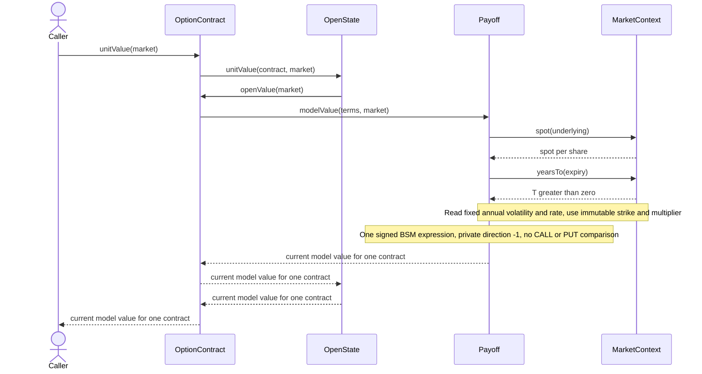

# A put's value before expiry

The caller requests the current value of one issued put contract, while its
state is Open and the valuation date is strictly before expiry. Payoff is a
PutPayoff instance, using the inherited SignedVanillaPayoff calculation.

The multiplier is applied inside Payoff.modelValue exactly once. A Position
then multiplies this unit value by its signed units. The returned number is
neither intrinsic value alone nor profit after the historical premium.
No fabricated numerical BSM result is reported for unspecified inputs.
